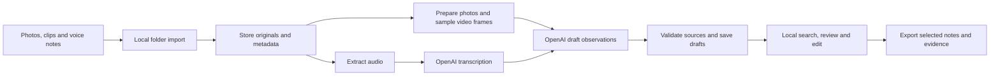

# Windows inspection notebook design

Build a notebook for observations collected during a long inspection. Each
photo, narrated clip, or voice note becomes searchable evidence and a draft
note that the inspector can correct, group, and copy into an existing report.
An observation is the core unit; it can be useful before the rest of the
inspection is complete.

For the first pilot, use a portable Windows app that reads a selected folder,
prepares media locally, and opens a review interface in the laptop's browser.
All AI inference uses OpenAI APIs. The user confirmed that light local media
preparation is acceptable and that this first pass should deliver a concrete
design and implementation plan. No hosted service is needed for the demo.

## The first useful workflow

1. During inspection, take photos or short videos with the phone's existing
   camera app. Narrate what matters: location, equipment identifier, what
   looks wrong, and what needs checking. A voice memo works when there is
   nothing useful to film. Recording the whole inspection is unnecessary.
2. Copy the original files into a folder. Open the app, create an inspection,
   select its date and timezone, and choose that folder. Show an inventory
   before the user starts processing; nothing uploads merely because it was
   selected. New files can be imported into the same inspection later.
3. Process each file independently. Show per-file progress and errors, so a
   corrupt clip does not prevent the other observations from appearing.
4. Review a chronological list of draft observations. Each note opens beside
   its photo, sampled video frames, or playable recording and transcript.
   Missing recording times appear in an explicit unknown-time group.
5. Search by phrase, equipment identifier, area, or tag. Correct a note, mark
   it reviewed, and optionally combine related observations.
6. Select useful observations and export a Word document and an evidence
   folder, or copy individual notes into the lab's existing report template.

Suggested narration: “Room two, equipment cabinet C-17. The service label is
partly detached. I cannot read the service date. Check the maintenance log.”
This is guidance, not a required script. Photos without narration remain useful.

## What an observation should say

The assistant preserves different sources of knowledge explicitly:

| Field | Example | Basis |
| --- | --- | --- |
| Inspector account | Service label partly detached; service date unreadable | Transcript, with access to recording |
| Visible detail | Label corner appears lifted | Named photo or frame |
| Draft note | Inspector reported a partly detached service label on cabinet C-17 | Editable AI summary with supporting references |
| Follow-up | Check the maintenance log | Inspector's stated request |
| Open question | What service date is recorded in the log? | Missing information, not an inferred failure |
| SOP reference | None supplied | Empty until a real document or user reference supports it |
| Review state | Draft | Changed to reviewed only by a person |

The note must not turn “date unreadable” into “maintenance overdue.” If
the recording and image disagree, preserve both accounts and ask for review.
Allow observations with no apparent problem, multiple issues in one clip,
and evidence that cannot support a useful interpretation.

Keep the raw transcript separate from an edited version. Every factual claim
in a generated note carries a source reference. An observation can cite a
whole clip when finer alignment is unavailable. A source link establishes
traceability; it does not establish that the model interpreted it correctly.

The [synthetic example](../examples/observation.json) shows a draft with an
unconfirmed photo association. Dates, people, and media are illustrative.

## Independent observations

Support photo-only, audio-only, and mixed inspections. Each fragment keeps
its own capture time and source identity. A photo is first-class evidence,
and a crop is an additional view alongside the uncropped original.

Use staged processing, cached intermediate results, image candidates,
direct API calls, and editable structured output. Regenerating an export
from reviewed observations should not require another model call.

An hours-long inspection may produce only a few minutes of evidence. Draft
notes describe recorded observations; they cannot establish that unrecorded
inspection steps were completed.

## Windows delivery and processing location

| | Portable desktop app — proposed first pilot | Browser and remote service — later alternative |
| --- | --- | --- |
| Laptop requirements | Permission to run an executable; internet for AI processing | Browser, internet, permission to upload the selected material |
| Media preparation | Bundled utilities run on laptop; no local AI models | Remote CPU worker runs metadata extraction and FFmpeg |
| AI calls | Local process calls OpenAI; key stays outside page JavaScript | Service calls OpenAI with server-side credentials |
| Storage | Inspection folder and local database | Private service storage plus downloadable evidence package |
| Tradeoff | Requires Windows packaging and local execution permission | Requires hosting, access control, and upload time |

Use one local application, one background worker, a durable job table, and
SQLite. Bind the review server only to 127.0.0.1 on an available port. Use a
per-launch session token and check request origin on mutations so another
website cannot submit processing or editing requests to the local app. A
native file picker chooses the import folder; there is no automatic watcher.

Copy originals into the inspection workspace once, recording their original
paths and content hashes. Identify repeated imports by content even when
filenames change. Return the existing asset on duplicate import into the same
inspection; cross-inspection reuse must be explicit. Preserve originals and
keep previews, extracted audio, and frames as separate derivatives.

Package Python and the chosen FFmpeg distribution in a portable folder.
The inspector extracts a ZIP and opens `Sopmaker.exe`; Python, Homebrew,
Docker, and agent CLIs are not prerequisites. Build and smoke-test that
distribution on Windows: PyInstaller's Windows outputs require a Windows
build environment. [PyInstaller manual](https://pyinstaller.org/en/stable/)

Use Windows Credential Manager for the API key, entered in a native settings
dialog. An environment variable is a developer-only alternative. Browser
JavaScript never receives the key. Explain that audio, selected frames, and
photo derivatives are sent to OpenAI; local storage does not mean offline AI.
Import, existing-note search, review, and export work without a connection.

If running an executable is later ruled out, move the processing core to a
remote service and replace folder selection with explicit uploads. That
variant requires sign-in, HTTPS, private storage, and interrupted-upload
recovery. It is not part of the first implementation.

## Processing pipeline

1. **Inventory.** Record original filename, content hash, import time, media
   type, duration, and raw capture metadata. Keep the original bytes unchanged.
   Begin with JPEG/PNG, MP4/MOV, and M4A/MP3/WAV. Make HEIC support an explicit
   capability check against the actual phone files and chosen decoder.
2. **Prepare.** Read photo EXIF and video/container metadata before conversion.
   Generate orientation-correct previews. For a short video, initially sample
   a bounded set of frames spread through the clip, keeping exact offsets;
   allow further extraction when a reviewer needs another moment. Sampling
   can miss a brief event, so the original remains playable and selectable.
   Check playback against actual phone codecs; generate a browser-compatible
   preview when needed without replacing the original. Limit local media
   preparation to one active file to keep the office laptop responsive.
3. **Transcribe.** Send extracted audio to the transcription API. Preserve
   empty/no-speech results instead of manufacturing narration. Supply a small
   lab vocabulary for equipment names and abbreviations. Show uncertain
   identifiers for correction against the recording.
4. **Extract.** Submit one fragment's transcript and labeled photos/frames
   to a vision-capable model through the Responses API with a strict output
   schema. Ask for observations, supported claims, missing information, and
   suggested tags. Permit zero observations. Do not send the entire inspection
   history for every clip.
5. **Validate.** Reject nonexistent source IDs, nonexistent frame IDs, invalid
   offsets, and unsupported review-state changes. Verify quoted text against
   the stored transcript. Save the raw response, resolved model, prompt version,
   source IDs, and usage separately from human edits.
6. **Index and render.** Index transcripts, observations, identifiers, and
   reviewer notes with SQLite full-text search. Search results open the
   supporting evidence. Embeddings or a chat interface can follow if real
   searches show that keyword search is insufficient.

Use durable stages per asset: imported, prepared, transcribed, drafted, indexed.
Mark inapplicable stages skipped. Hash the inputs, settings, prompt version,
and model configuration used by each stage. Resume from the last valid stage;
a changed prompt invalidates draft generation, not audio extraction. An API
timeout may have incurred a charge: show an uncertain outcome and require an
explicit retry rather than silently submitting repeated expensive requests.

Track processing state separately from human review. Reprocessing creates a
new draft revision and never replaces a reviewed note. Record who edited
or reviewed a revision and when. Import, export, and note editing remain
deterministic operations without model calls.

## Capture time and fragment association

Store four distinct concepts: the raw device timestamp, interpreted capture
time, import time, and a frame's or audio segment's offset within its source.
Keep the timezone and basis of every interpretation. Photo EXIF is one
source of capture time, as documented by Microsoft's
[DateTaken property](https://learn.microsoft.com/en-us/windows/win32/properties/props-system-photo-datetaken).

Prefer embedded original-capture metadata with an explicit offset. If only
a local time exists, use the inspection's selected timezone and label that
assumption. Preserve conflicts between metadata fields. A file modification
time may reflect copying or editing; display it only as an approximate
fallback. Filename dates are hints. Otherwise leave capture time unknown
and allow a recorded human correction, including device clock adjustments.

Order fragments by interpreted capture time, with stable tie-breaking and
an unknown-time group. Never close real gaps by concatenating clips. Avoid
false precision around daylight-saving changes and inconsistent device clocks.

Initially create observations per fragment. Offer nearby photos as possible
related evidence; time proximity alone cannot attach them as factual support.
Keep proposed, confirmed, and rejected associations distinct. The reviewer
can merge or split observations without losing source IDs or prior revisions.

## API choices that affect the design

Current OpenAI documentation recommends `gpt-transcribe` for file
transcription. It documents a 25 MB input limit and places fine-grained
timestamp examples on deprecated model paths. Start with clip-level transcript
references. If a longer recording is chunked, preserve chunk boundaries and
label those as coarse ranges; do not invent word-level alignment. Configure
the model and verify needed output fields with an actual API smoke test.
[File transcription](https://developers.openai.com/api/docs/guides/speech-to-text)

Use image inputs for photos and extracted frames. Keep model selection
configurable and validate image-input and structured-output support for the
chosen account before the pilot. Images can be misread, particularly small
labels; provide the original and request human confirmation of important
identifiers. [Images and vision](https://developers.openai.com/api/docs/guides/images-vision)

Structured Outputs constrain response shape, but factual claims still need
validation and review. Support refusal and incomplete-response outcomes.
[Structured outputs](https://developers.openai.com/api/docs/guides/structured-outputs)

For the first demo, use staged, non-identifying material. The import screen
must make external processing clear. Real lab data needs the lab's agreement
on the permitted service, account, and retention. Use `store: false` for
Responses requests, while explaining that this does not eliminate provider
abuse-monitoring retention. Keep API keys out of exports, logs, and browser
code. [OpenAI data controls](https://developers.openai.com/api/docs/guides/your-data)

## Existing SOPs and senior colleagues' knowledge

The first demonstration works without SOP ingestion: it records what the
inspector says, what evidence exists, and what remains unresolved. Let the
reviewer attach an SOP identifier or selected excerpt with its version and
page/section. A recalled rule is recorded as the colleague's account, pending
document verification.

In a later increment, import a small, explicitly selected SOP set. Extract
PDF/DOCX text with document identity, revision, effective date, page/section,
and applicable inspection scope. Scanned pages require OCR. Offer candidate
passages beside observations and label them as candidates; do not declare
noncompliance merely because a similarity search found a passage. Preserve
conflicting or superseded documents for human resolution.

Voice explanations from senior staff can become attributed knowledge notes.
Keep those separate from approved procedures until a human promotes the
content through the lab's existing documentation process.

## Screens and export

The initial interface needs three views: an inspection's file inventory and
processing progress; a searchable observation list; and a review view with the
note beside the media. Show the note's status, source links, open questions,
and export selection without exposing pipeline internals in the main flow.

Use separate filters for draft/reviewed, area, identifier, and follow-up.
Retain note text typed by the inspector even if the API is unavailable.
Multiple draft observations may refer to one clip.

Export only the user's selected observations. Default to reviewed notes,
with an explicit option to include visibly marked drafts. A DOCX contains
editable note text, thumbnails, source filenames, capture-time basis, and
clip offsets where known. Include a relative-path HTML evidence index and
originals in a ZIP, plus machine-readable JSON and a CSV observations table.
Verify that the evidence index works after extraction on another Windows
machine; avoid dependencies on expiring hosted URLs or developer paths.

## Build sequence and pilot criteria

Use Python 3.13 for the application core, the official OpenAI Python SDK for
API calls, Pydantic for model response types, Pillow for JPEG/PNG previews and
EXIF, SQLite for records/search/jobs, and `python-docx` for editable Word
export. Use bundled `ffmpeg`/`ffprobe` for video and audio. A small stdlib HTTP
server and plain HTML/CSS/JavaScript can provide the local review interface;
native Tk dialogs cover folder selection and key entry. Package with
PyInstaller on a Windows runner and include third-party license notices.
Confirm those dependencies and their versions in the first implementation
step rather than shipping an unpinned development environment.

Proposed module boundaries:

| Module | Responsibility |
| --- | --- |
| `app.py`, `web/` | Launch, loopback session, inventory/review/search interface, controlled shutdown |
| `importer.py`, `metadata.py` | Folder inventory, stable asset IDs, hashing, original copies, capture-time interpretation |
| `media.py` | Discover bundled tools, prepare audio/photos/frames/previews, retain source offsets |
| `models.py`, `store.py` | Typed observations, SQLite migrations, revisions, full-text index, durable job states |
| `providers/openai.py`, `prompts/` | Transcription and observation extraction, model configuration, validated source references |
| `worker.py` | Per-file staged jobs, cancellation between stages, resumability and failure reporting |
| `exporter.py` | Selected-note DOCX/CSV/JSON and portable HTML evidence package |
| `packaging/` | Windows build specification, pinned dependencies, bundled media utilities and notices |

An inspection workspace contains `inspection.sqlite3`, `originals/`,
`derived/`, `model-runs/`, and `exports/`. Keep workspace backups independent
of the executable folder so updating the app does not replace inspection data.
Model-run records contain no API key. Use database transactions and atomic
file replacement so an interrupted process cannot present partial results
as completed stages.

| Increment | Deliverable | Evidence that it works |
| --- | --- | --- |
| 1 | Import, media metadata, durable stages, OpenAI adapters, saved observations | A real photo, narrated clip, and voice note produce source-linked records; photo-only input works |
| 2 | Search and side-by-side review with edits and revisions | Inspector finds an identifier, checks the recording, corrects a note, and marks it reviewed |
| 3 | Selected-note DOCX and portable evidence export | Notes are editable in Word and evidence opens on the target Windows laptop |
| 4 | Portable Windows delivery and representative pilot | Extract ZIP and open the app on the target laptop without a development environment |

Start increment 1 with a developer CLI sharing the eventual desktop core:
inventory a folder, process it into a workspace, and render an evidence index.
Keep these as planned commands until implemented. Prove one real end-to-end
API path before building the full interface. Pin a selected vision model only
after checking its image/schema capabilities and draft quality on the staged
fixture set. Then add the desktop launcher and review interface in increment 2.

Verification should focus on provenance validation, time ambiguity, repeated
imports, interrupted stages, preserving edits during reprocessing, and export
relocation. Run small live API smoke tests on staged media as well as offline
fixtures. Run the packaged application on Windows; successful development
tests on macOS are insufficient evidence of Windows delivery.

Use a proposed pilot set of ten photos, five short narrated clips, two voice
notes, and at least one silent clip. Include duplicate imports, unknown
timestamps, a blurry label, two unrelated fragments recorded close together,
a corrupt file, a multiple-issue clip, and a narrated uncertainty. All media
is staged and non-identifying for this evaluation.

The proof of concept passes when:

- Every generated claim links to real supplied evidence; no identifiers,
  numerical readings, SOP requirements, or compliance conclusions are invented.
- The inspector can locate three predefined observations and open their
  evidence without browsing the original folder manually.
- Re-import and restart reuse completed stages. One failed file does not
  erase other observations, and reprocessing preserves reviewer edits.
- Missing capture time is visible; temporal proximity does not silently merge
  unrelated material. Photo-only and silent media retain useful evidence.
- Selected notes can be pasted or exported into the existing report workflow
  with source references intact on the Windows laptop.
- Record preparation time, processing latency, API usage/cost, correction
  rate, and manual reporting time saved. Report measured results before
  setting cost or speed promises.

The first product question is whether this reduces the effort of finding and
writing inspection evidence. Full report generation and automatic compliance
assessment can wait until that benefit is demonstrated.
